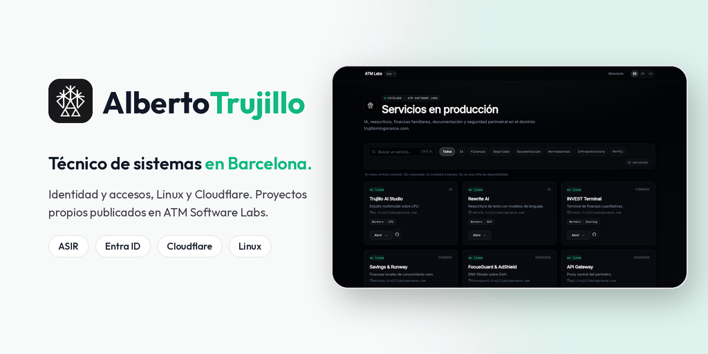

**Técnico de sistemas en Barcelona. Identidad y accesos, Linux y Cloudflare. ASIR.**

<em>Systems technician in Barcelona: identity and access, Linux and Cloudflare.</em>

 

[Portfolio](https://alberto.trujillomingorance.com) · [Labs](https://labs.trujillomingorance.com) · [Guías](https://guides.trujillomingorance.com) · [Email](mailto:alberto@trujillomingorance.com)

 

---

## Proyectos

Todo lo público está en [ATM Software Labs](https://github.com/ATM-Software-Labs). Son proyectos personales desplegados en Cloudflare con mi dominio.

| Proyecto | Qué es | Web |
|---|---|---|
| [NutriFit](https://github.com/ATM-Software-Labs/nutrifit) | App de nutrición y macros con IA, PWA y APK | [nutri.trujillomingorance.com](https://nutri.trujillomingorance.com) |
| [Trujillo Guides](https://github.com/ATM-Software-Labs/trujillo-guides) | Guías técnicas de sistemas, correo y Cloudflare | [guides.trujillomingorance.com](https://guides.trujillomingorance.com) |
| [Rewrite](https://github.com/ATM-Software-Labs/rewrite-ai) | Reescritura y corrección de textos con modelos de lenguaje | [rewrite.trujillomingorance.com](https://rewrite.trujillomingorance.com) |
| [INVEST](https://github.com/ATM-Software-Labs/invest-platform) | Comparador y consulta de acciones, ETF y cripto | [invest.trujillomingorance.com](https://invest.trujillomingorance.com) |
| [ATM Tools](https://github.com/ATM-Software-Labs/atm-tools) | Herramientas que funcionan en el navegador, sin backend | [tools.trujillomingorance.com](https://tools.trujillomingorance.com) |
| [FocusGuard](https://github.com/ATM-Software-Labs/focusguard-saas) | Panel de filtrado DNS con Cloudflare Zero Trust | [focusguard.trujillomingorance.com](https://focusguard.trujillomingorance.com) |
| [AI Studio](https://github.com/ATM-Software-Labs/trujillo-ai-studio) | Chat e imágenes con IA y bot de Discord en Workers | [ai.trujillomingorance.com](https://ai.trujillomingorance.com) |
| [ATM Labs](https://github.com/ATM-Software-Labs/atm-labs-hub) | Directorio de los servicios y su estado | [labs.trujillomingorance.com](https://labs.trujillomingorance.com) |
| [Portfolio](https://github.com/ATM-Software-Labs/portfolio) | Mi CV y experiencia | [alberto.trujillomingorance.com](https://alberto.trujillomingorance.com) |
| [domain-root](https://github.com/ATM-Software-Labs/domain-root) | Página del dominio raíz | [trujillomingorance.com](https://trujillomingorance.com) |
| [OpenSentinel](https://github.com/ATM-Software-Labs/open-sentinel) | Aviso de arranque y panel local para un PC con Windows | Se instala en local |

## Contacto

[alberto@trujillomingorance.com](mailto:alberto@trujillomingorance.com) · [Portfolio](https://alberto.trujillomingorance.com)

---

© 2026 ATM Software Labs

